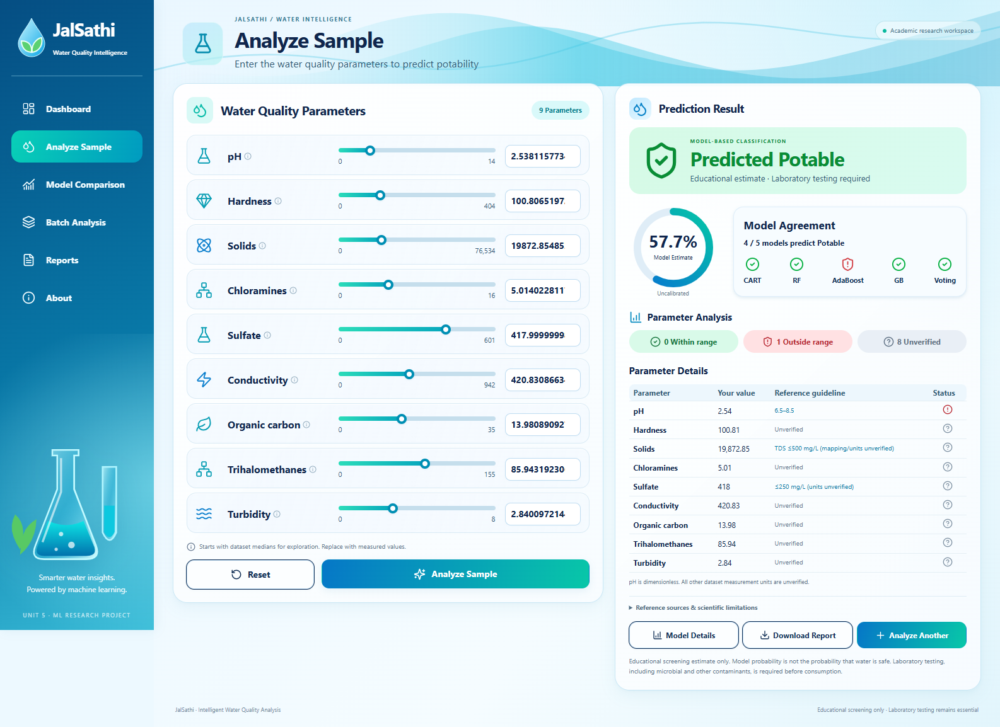

# JalSathi — Intelligent Water Quality Analysis & Prediction

Smarter Water Insights, Powered by Machine Learning.

An educational application with five genuinely trained classifiers, a React Aqua Glass interface, FastAPI inference, persistent analysis history, CSV batch processing and PDF reports. Predictions are educational screening estimates, not drinking-water safety determinations.

**Live application: [jalsathi-ridcyber.vercel.app](https://jalsathi-ridcyber.vercel.app)** · [API health](https://jalsathi-ridcyber.vercel.app/api/v1/health) · [API docs](https://jalsathi-ridcyber.vercel.app/docs)

Production runs the full FastAPI backend and Vite frontend on Vercel, with a dedicated Neon PostgreSQL Free database. Local development uses SQLite. See [deployment setup](docs/DEPLOYMENT.md) and [production verification](reports/deployment/DEPLOYMENT_VERIFICATION.md). This is an anonymous shared demo: visitors can see saved history and reports, so use demonstration measurements without personal information.

Public release verification: all six routes and refreshes, both prediction states, five-row CSV upload/export, malformed CSV feedback, PDF downloads and durable history passed. Chrome workflows passed at desktop, tablet and mobile sizes. Row 250 remains Predicted Potable with RF class-1 estimate **0.6263747470354587** and **3/5** agreement. [Verified positive inputs and provenance](reports/testing/VERIFIED_POTABLE_EXAMPLES.md) and the [uploadable CSV](tests/fixtures/verified_potable_samples.csv) are included.



## Verified project status

The complete QA audit uses separate databases and preserves the original dataset, fitted models and user analysis history. Read the [final QA report](reports/testing/JALSATHI_FINAL_QA_REPORT.md), [model diversity analysis](reports/testing/MODEL_DIVERSITY_ANALYSIS.md), [CSV results](reports/testing/CSV_TEST_RESULTS.md), and [bug-fix log](reports/testing/BUG_FIX_LOG.md).

| Model | Test accuracy | Potable F1 | Potable recall | Balanced accuracy |
|---|---:|---:|---:|---:|
| CART | 61.28% | 47.74% | 45.31% | 58.41% |
| Random Forest (primary) | 65.24% | 48.42% | 41.80% | 61.02% |
| AdaBoost | 62.04% | 9.45% | 5.08% | 51.79% |
| Gradient Boosting | 65.70% | 39.02% | 28.12% | 58.94% |
| Voting Ensemble | 66.62% | 40.00% | 28.52% | 59.76% |

These are actual results on 656 held-out observations. Primary selection used **training CV**, not this table. AdaBoost predicts potable for just 19/656 test samples, explaining its low F1; pipeline, feature order, probabilities and thresholds were independently checked. Random Forest produces 186 potable and 470 non-potable predictions with 656 distinct probabilities. Neither model results nor thresholds were manipulated for the demo.

The audit includes 100 labeled held-out records, 220 diverse unlabeled functional inputs, all 15 CSV fixtures, 500 model-wise direct/single/batch comparisons and 50 real edited browser-form submissions. Synthetic fixtures have no invented potability labels. Trained models and their original metrics are included to make the local application runnable after dependency installation.

Final verification: **52/52 automated tests passed**, plus **2,305/2,305 audit checks**. Backend application coverage is **97%**. The verdict is **PASS WITH LIMITATIONS**, reflecting dataset uncertainty and weak minority-class recall rather than an application failure. Original model artifacts and thresholds are unchanged.

## Clone

```powershell
git clone https://github.com/riddhicodesavvy/JalSathi.git
cd JalSathi
```

## Start the installed application (PowerShell)

From the project root:

```powershell
./scripts/start.ps1
```

Open **http://127.0.0.1:5173**. The script starts the API in a hidden process and runs Vite in the current terminal; Ctrl+C stops the launched API. Ports 8000 and 5173 must be free. Swagger UI: http://127.0.0.1:8000/docs.

Or run two terminals, both starting at the repository root:

```powershell
# Terminal 1
./.venv/Scripts/python.exe -m uvicorn backend.app.main:app --host 127.0.0.1 --port 8000
```

```powershell
# Terminal 2
cd frontend
npm run dev
```

## Reproduce from a clean checkout

Use Python 3.12+ and Node 22.12+ (Node 22.16 was tested). PowerShell:

```powershell
./scripts/setup.ps1
```

The script creates `.venv`, installs the saved Python dependency versions and npm lockfile, trains all models, runs the optional extension demonstrations, and regenerates evaluation evidence. The original CSV and prior EDA are never rewritten. On this machine, Windows Store `python.exe` is inaccessible; the setup script detects the Codex bundled Python runtime as an alternative. On other machines install ordinary Python 3.12+.

To use the included trusted model artifacts immediately after cloning, install dependencies without retraining:

```powershell
python -m venv .venv
./.venv/Scripts/python.exe -m pip install -r backend/requirements.lock.txt
cd frontend
npm ci
cd ..
./scripts/start.ps1
```

The included models were trained using scikit-learn 1.8.0. Use the locked environment when loading them; retrain with `python -m ml.train` if changing the ML package versions. Python joblib/pickle files must only be loaded from trusted sources.

Manual/cross-platform setup:

```bash
python -m venv .venv
# Windows Python: .venv/Scripts/python.exe; Linux/macOS: .venv/bin/python
python -m pip install -r backend/requirements.txt
cd frontend
npm ci
cd ..
python -m ml.train
python -m ml.extensions
python -m scripts.verify_artifacts
python -m uvicorn backend.app.main:app --host 127.0.0.1 --port 8000
```

Activate the virtual environment before using the unqualified `python` commands above. `backend/requirements.lock.txt` records the exact Windows/Python 3.12 verification environment; the bounded requirements file is available for other platforms. No cloud keys are needed.

## Features

- Dashboard: verified dataset counts, class distribution, actual model metrics, recent analyses and quick actions.
- Analyze Sample: synchronized numeric/sliding inputs, validation, five predictions, actual model agreement, uncalibrated model estimate, independent reference checks, CART decision path and PDF download.
- Model Comparison: sortable metrics, confusion matrices, ROC and precision-recall curves, per-model permutation importance, fitted CART diagram, threshold/error analysis and algorithm explanations.
- Batch Analysis: drag-and-drop UTF-8 CSV, 2 MB/1,000-row limits, row-level errors, vectorized model inference, class totals, search/filter/sort/pagination and CSV export.
- Reports: paginated persisted analyses, report preview and on-demand PDF generation.
- About: actual dataset metadata, Unit 5 mapping, workflow, fitted GAM effects and honestly labeled advanced-method limitations.

## Data and artifacts

The preserved source is `water_potability.csv`: 3,276 records, nine features, Potability target (1,998 non-potable; 1,278 potable). Missing values: pH 491, Sulfate 781, Trihalomethanes 162. Its SHA-256, actual statistics, duplicates and outlier flags are in `reports/JALSATHI_DATASET_ANALYSIS.md` and `ml/artifacts/registry.json`.

Training uses a fixed stratified 80/20 split, seed 42, three-fold tuning entirely inside training, median-imputation pipelines, and independent CART, Random Forest, AdaBoost, Gradient Boosting and soft Voting classifiers. The primary model is Random Forest, selected on training CV balanced accuracy with Brier score as a tie-break. All stored probabilities are explicitly uncalibrated.

See `reports/evaluations/MODEL_EVALUATION.md` for the actual metric table, `model_metrics.csv` for machine-readable results, and `ml/artifacts/plots` for evaluation diagrams. The ensemble is not assumed to outperform its members.

## Verification

```powershell
./.venv/Scripts/python.exe -m pytest --cov=backend/app --cov-report=term-missing
./.venv/Scripts/python.exe -m ruff check backend ml scripts
cd frontend
npm run lint
npm test
npm run build
# Start backend and frontend first; Chrome must be installed:
npm run e2e
```

Playwright runs real desktop and mobile workflows, including downloads, CSV analysis, navigation, slider synchronization, validation and an isolated simulated API failure. Browser screenshots are saved under `frontend/test-results`. Tests use a separate SQLite database and report directory. Windows asyncio/TestClient requires local socket access even for in-process tests. In restricted Codex environments, allow loopback access to run them.

Run the full reproducible ML/API audit from the root:

```powershell
./.venv/Scripts/python.exe -m tests.generate_test_csvs
./.venv/Scripts/python.exe -m tests.run_audit
```

For the extended browser audit, start an isolated API and frontend in separate terminals:

```powershell
$env:JALSATHI_DATABASE='sqlite:///runtime/qa-browser.sqlite'
$env:JALSATHI_REPORTS='runtime/qa-browser-reports'
$env:JALSATHI_ORIGINS='http://127.0.0.1:5175'
./.venv/Scripts/python.exe -m uvicorn backend.app.main:app --host 127.0.0.1 --port 8001
```

```powershell
cd frontend
$env:VITE_API_URL='http://127.0.0.1:8001/api/v1'
node node_modules/vite/bin/vite.js --host 127.0.0.1 --port 5175 --strictPort
```

```powershell
cd frontend
node node_modules/@playwright/test/cli.js test --config playwright.qa.config.ts
```

Audit CSV provenance, row identifiers and ground-truth labels are documented in `tests/fixtures/csv/README.md` and the separate manifest. Production application history is never used by these audit workflows. Databases, environment secrets, virtual environments, node_modules, generated runtime reports and private audit snapshots are excluded from Git.

## Project layout

```text
backend/app/       API, schemas, inference, standards, database, reporting
backend/tests/     API, data, artifact, extension and report verification
frontend/src/      React pages, reusable components, typed API client, design system
frontend/e2e/      Real browser workflows
ml/               Data validation, reproducible core and extension training
ml/artifacts/     Trusted fitted pipelines, metadata and plots
data/samples/     Genuine complete source rows for demonstrations
reports/eda/      Original preserved analytical work
reports/evaluations/  Actual evaluation evidence
docs/             Architecture, methodology, API, limitations and faculty guide
scripts/          Windows setup/start and artifact verification
runtime/          Local SQLite data and generated reports (ignored)
```

## Configuration and limitations

Environment variables are documented in `.env.example`. Set them in your shell; this application does not automatically load `.env`. The frontend defaults to a Vite `/api` proxy and supports `VITE_API_URL`. Backend paths, database URL and permitted origins are configurable.

Only dimensionless pH receives an active EPA secondary-reference check. Other dataset units and threshold mappings are not independently verified, so the UI marks them unverified. EPA secondary guidance addresses aesthetic/corrosion characteristics; it is not BIS certification or complete health testing. WHO and BIS health/operational standards cannot responsibly be mapped to this CSV without verified measurement context. No fabricated borderline category is used.

Advanced extensions: an actual penalized additive logistic spline GAM is trained; validation-likelihood averaging is explicitly a plug-in approximation, not rigorous BMA. Adaptive MARS and SHAP are not implemented; fitted CART paths and measured permutation importance supply real explanations. Probabilistic calibration has not been applied; no displayed percentage should be read as a safety probability.

The public deployment uses HTTPS and durable PostgreSQL history. It remains an educational shared demo, without private user accounts or laboratory certification. Private laboratory use requires authentication, authorization, backup policy and appropriate health-domain review. Only trusted bundled model artifacts are loaded; uploaded pickle/joblib artifacts are never accepted. Free hosting quotas can limit availability.

Further reading: [architecture](docs/ARCHITECTURE.md), [methodology](docs/ML_METHODOLOGY.md), [dataset limitations](docs/DATASET_LIMITATIONS.md), [API](docs/API_DOCUMENTATION.md), [Unit 5 mapping](docs/UNIT5_SYLLABUS_MAPPING.md), [faculty demo](docs/FACULTY_DEMO.md).
